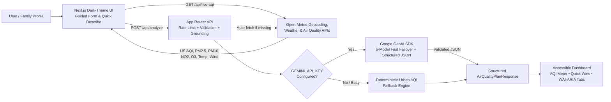

# Urban Air Quality Assistant — PromptWars Main Challenge 06

An interactive, production-ready GenAI web application that analyzes a household's daily routine, commute patterns, residential environment, and health sensitivities to generate tailored **low-emission routines**, **cost-tiered indoor air quality hacks** (optimized for winter smog and high-AQI episodes), and **plain-language health and environmental impact explanations**.

---

## Challenge 06 Alignment Matrix

| PromptWars Challenge 06 Objective | Implemented Solution & Module |
| --- | --- |
| **1. Analyze Daily Routines & Context** | Guided Form + Quick Describe natural-language input ([RoutineInputForm.tsx](src/components/RoutineInputForm.tsx)), household sensitivity tags ([FamilyMembersEditor.tsx](src/components/FamilyMembersEditor.tsx)), and automatic Open-Meteo real-time city telemetry ([air-quality-api.ts](src/lib/air-quality-api.ts)). |
| **2. Tailored Low-Emission Routines** | Commute shifts, trip batching, and inversion-aware outdoor scheduling with weekly `kg CO₂ saved`, exposure reduction `%`, and feasibility tags ([gemini.ts](src/lib/gemini.ts), [DashboardTabsContent.tsx](src/components/dashboard/DashboardTabsContent.tsx)). |
| **3. Indoor AQI & Winter Smog Hacks** | Free & low-cost home techniques (DIY Corsi-Rosenthal MERV-13 fan filters, draft sealing, damp-mopping, kitchen exhaust discipline) prioritized by `winterSmogSpecific` flag and home type ([fallback.ts](src/lib/fallback.ts), [DashboardTabsContent.tsx](src/components/dashboard/DashboardTabsContent.tsx)). |
| **4. Health & Emission Impact Explanations** | Transparent cause-and-effect cards translating every recommendation into plain-language health benefits, pollutant reductions, and sensitive member beneficiaries ([AqiSummaryCard.tsx](src/components/AqiSummaryCard.tsx), [AirQualityDashboard.tsx](src/components/AirQualityDashboard.tsx)). |

---

## Architecture Overview



### Modular Directory Structure

- `src/types/air-quality.ts` — Documented TypeScript interfaces for household inputs, live telemetry, AQI summaries, routines, indoor hacks, and impact cards.
- `src/lib/presets.ts` — Shared allowlists (`HOME_TYPES`, `COMMUTE_MODES`, `SENSITIVITIES`) and one-tap urban scenarios (`SCENARIO_PRESETS`).
- `src/lib/validation.ts` — Strict runtime schema validation, enum allowlists, string length capping, telemetry sanity checking, and prompt-injection delimiter neutralization.
- `src/lib/rate-limit.ts` — Bounded per-IP fixed-window rate limiter emitting `X-RateLimit-*` and `Retry-After` headers.
- `src/lib/air-quality-api.ts` — Open-Meteo geocoding, weather, and pollutant integration with `2s` timeouts and `300s` revalidation.
- `src/lib/gemini.ts` — `@google/genai` client with XML-delimited prompt data, strict `responseSchema`, `6s` per-model timeout across a 5-model fast-failover cascade (`gemini-3.5-flash-lite` → `gemini-3.6-flash` → `gemini-3.1-flash-lite` → `gemini-3.8-flash` → `gemini-4-hydrogen`), and secret redaction.
- `src/lib/fallback.ts` — Modular deterministic offline engine guaranteeing structured, sensitivity-aware guidance during API outages.
- `src/lib/analyze-service.ts` — Transport-agnostic request orchestration (`processAnalyzeRequest`, `processLiveAqiRequest`) decoupled from Next.js route wrappers for direct integration testing.
- `src/app/api/analyze/route.ts` & `src/app/api/live-aqi/route.ts` — Thin App Router handlers enforcing JSON parsing and delegating to `analyze-service.ts`.
- `src/components/` — Accessible, modular UI components (`RoutineInputForm`, `FamilyMembersEditor`, `LiveTelemetryBanner`, `AqiSummaryCard`, `AirQualityDashboard`, `dashboard/DashboardTabsContent`, `ErrorBoundary`).

---

## Security, Accessibility & Quality Engineering

- **Security Hardening**: Strict HTTP security headers in `next.config.ts` (`Content-Security-Policy` without production `unsafe-eval`, `X-Frame-Options: DENY`, `X-Content-Type-Options: nosniff`, `Strict-Transport-Security`, `Referrer-Policy`, `Permissions-Policy`, `poweredByHeader: false`), per-IP rate limiting (`429`), 50 KB request limits (`413`), enum allowlists, secret redaction, and XML prompt delimiters.
- **Accessibility (WCAG 2.1 AA)**: Skip-to-content navigation link, strict `h1 -> h2 -> h3 -> h4` heading hierarchy, high-contrast focus outlines (`:focus-visible`), `prefers-reduced-motion` support, WAI-ARIA `tablist`/`tab`/`tabpanel` with keyboard arrow navigation, ARIA `meter` on the AQI spectrum scale, `aria-live` status updates, and unique per-member form labels.
- **Reliability**: Route-level (`src/app/error.tsx`) and component-level (`ErrorBoundary.tsx`) error recovery plus deterministic fallback generation.

---

## Approach, Logic & Prompt Design Strategy

1. **Grounded Environmental Context**: Queries **Open-Meteo** (no API key required) concurrently for US AQI, PM2.5, PM10, NO₂, O₃, temperature, humidity, and wind speed, grounding both Gemini prompts and the fallback engine in real atmospheric conditions.
2. **Prompt Injection Defense & System Persona**: Frames Gemini as an empathetic **Urban Air Quality & Environmental Health Specialist** and isolates user free-text inside `<user_schedule>` and `<user_notes>` delimiters.
3. **Structured JSON Contract**: Uses `responseMimeType: "application/json"` with a typed `responseSchema` verified at runtime via `isValidPlanShape()`.

---

## API Reference

| Endpoint | Method | Purpose | Status Codes |
| --- | --- | --- | --- |
| `/api/analyze` | `POST` | Validate household profile, attach live telemetry, return full action plan | `200`, `400`, `413`, `429`, `500` |
| `/api/live-aqi?city=...` | `GET` | Fetch live Open-Meteo US AQI, pollutants, and weather for a city | `200`, `400`, `404`, `429` |

---

## Assumptions Made

- **AQI Scale**: Uses the **US EPA AQI** scale (`0–50 Good`, `51–100 Moderate`, `101–150 Unhealthy for Sensitive Groups`, `151–200 Unhealthy`, `201–300 Very Unhealthy`, `301+ Hazardous`).
- **Emission & Exposure Estimates**: Weekly CO₂ savings (`kg/week`) and exposure reduction percentages are practical educational estimates rather than clinical or sensor-calibrated measurements.
- **API Availability**: Open-Meteo lookups use `2s` timeouts; if unreachable, the app seamlessly uses city/season baseline heuristics.

---

## Local Setup & Verification

### Prerequisites
- Node.js 18+ (verified on Node v24)
- npm 9+
- Google Gemini API key from [Google AI Studio](https://aistudio.google.com/apikey) *(optional: offline smart baseline runs automatically when omitted)*

### Installation & Commands

```bash
# 1. Navigate to the project directory
cd urban-air-quality-assistant

# 2. Install dependencies
npm install

# 3. Configure environment variables
cp .env.example .env.local
# Edit .env.local and set GEMINI_API_KEY=your_actual_key

# 4. Run full verification suite (tests, lint, typecheck)
npm test
npm run lint
npx tsc --noEmit --incremental false

# 5. Build and run
npm run build
npm run dev
```

Open [http://localhost:3000](http://localhost:3000) in your browser. Licensed under the [MIT License](LICENSE).
